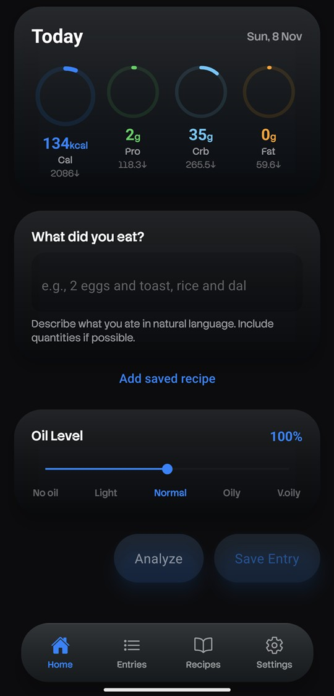
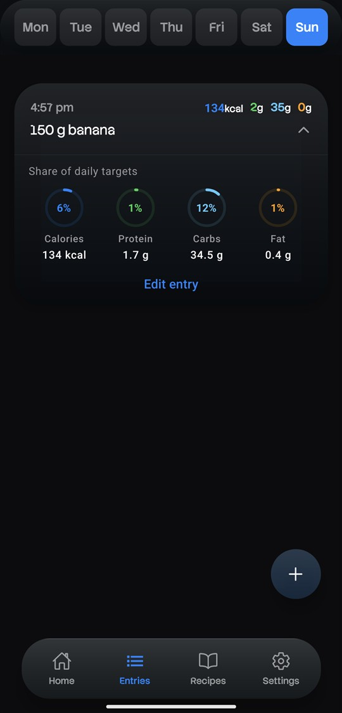
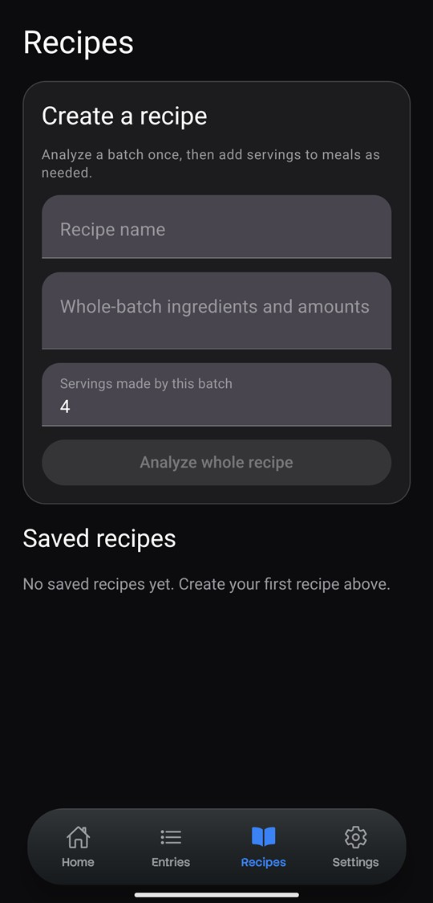

# JC

JC is an Android calorie and macro tracker for meals described in plain language, including home-cooked dishes such as “2 rotis with chicken curry.” It estimates calories, protein, carbs, and fat, and keeps your profiles, meals, and recipes on your device.

[Download the signed Android APK for Beta 2](https://github.com/SUNNY20052006/JC-calories-tracker/releases/tag/beta-v2)

## What improved in Beta 2

- **Fewer Gemini requests.** JC calculates supported plain weighed foods on the device and reuses saved estimates for exact repeat descriptions at the same oil setting. New or changed descriptions can go to Gemini. For example, “rice with chicken” and “fried rice with chicken” are separate cache entries.
- **Reusable recipes.** Analyze the whole batch once, then log one serving, a fractional serving, or the whole batch. When a meal combines saved recipes and new food, JC sends only the new text through analysis.
- **Local profiles and targets.** Onboarding estimates maintenance targets from profile details and activity, with manual targets available. Switch between profiles on the same device. Editing calories updates carbs while preserving protein and fat where feasible. Editing any macro recalculates calories.
- **Easier meal review.** Entries open with today selected and visible. Tap an entry or recipe to see its macro totals and dials. Recipes can be adjusted from the Home draft before saving.
- **Gemini usage in Settings.** Set a personal key, review seven days of activity, and see an estimate of requests remaining based on the daily budget and calls made on this device.

## Screenshots

<p align="center">
  
  
  
</p>

Captured from the installed Android beta using sample data.

## API and storage measurements

An offline replay compared the earlier Gemini-first route with Beta 2 over the same three-meals-per-day schedule, starting with an empty cache. It counted requests and estimated input and output tokens.

| Replay | Gemini requests | Estimated tokens |
| --- | --- | --- |
| 30 days | 90 → 28 (68.9% fewer) | 73,430 → 23,376 (68.2% fewer) |
| 365 days | 1,095 → 174 (84.1% fewer) | 893,577 → 144,760 (83.8% fewer) |

The one-profile sample SQLite database grew from **12 KiB** in the original app to **84 KiB** with 27 cached meals. The cache accounted for **12 KiB** of that footprint. The database measured **168 KiB** with 200 representative cache entries and **484 KiB** in a full-cache payload stress test. These figures measure disk storage. JC evicts the least recently used estimates at 200 entries per profile. Recent meal logs have a seven-day retention window. Recipes and cached estimates persist separately.

[Read the benchmark methodology, workload, and storage breakdown](docs/API_USAGE_SAVINGS.md)

## Using the Android build

Download the APK from the Beta 2 release, open it on your Android device, and complete local profile setup. The APK runs independently of Expo Go or a development server. The signed build was tested on a Samsung as an in-place upgrade from version 1.0.0.

To use live meal analysis or create a recipe, paste a personal API key with access to Gemini 2.5 Flash-Lite under **Settings → Gemini**. The APK ships without a bundled API key. It saves your personal key in Android SecureStore. Local meal estimates, saved recipe logging, and manual entry work offline. New descriptions sent for live analysis are processed by Gemini. [Get a key in Google AI Studio](https://aistudio.google.com/apikey)

## Development

The app uses React Native, Expo SDK 57, Expo Router, TypeScript, SQLite, and Gemini. Use Node 22.13 or later. The replay scripts use Node’s built-in SQLite module and run offline with sample data.

```bash
git clone https://github.com/SUNNY20052006/JC-calories-tracker.git
cd JC-calories-tracker
npm ci
npx expo start --go
```

On Windows, install Android SDK Platform Tools and an Expo Go version compatible with SDK 57. Enable USB debugging, connect the phone, accept its debugging prompt, and run `npm run start:usb`. The launcher forwards Metro over USB and opens the installed Expo Go.

```bash
npm test
npm run typecheck
npx expo export --platform android
node scripts/benchmark-gemini-savings.cjs
node scripts/benchmark-jc-storage.cjs
```

The EAS `preview` profile generates an Android APK with client environment substitution disabled. The upload allowlist excludes local environment files and test data.

## License

[MIT](LICENSE)
